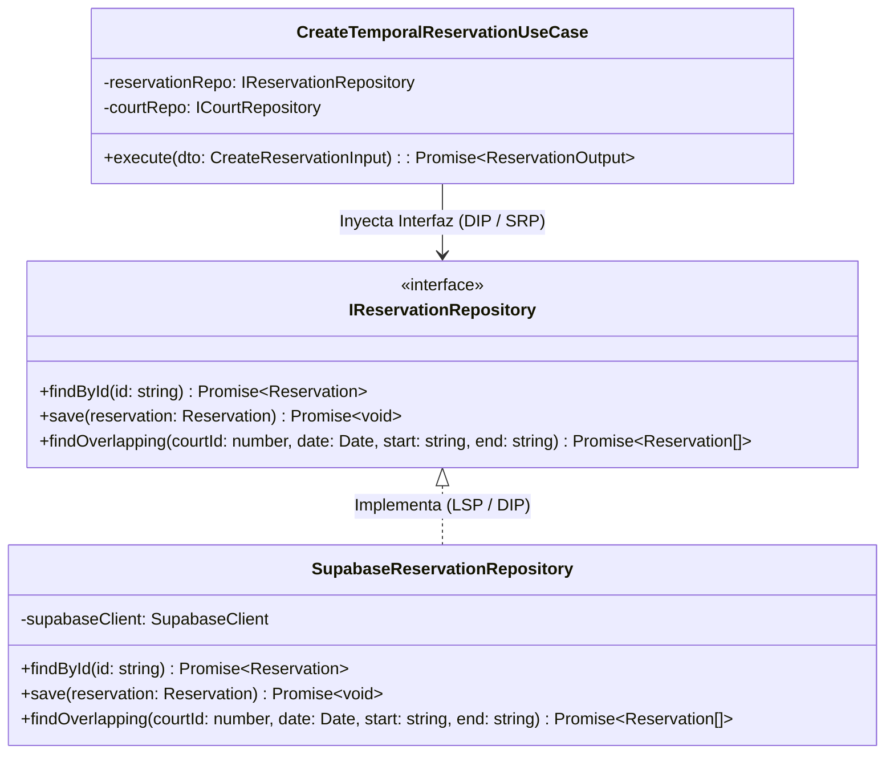

# 🏛️ Arquitectura por Capas y Principios SOLID

Este documento detalla la arquitectura de software del sistema, la separación estricta de responsabilidades entre capas y la aplicación rigurosa de los cinco principios **SOLID** para garantizar un código modular, altamente testeable, mantenible y desacoplado de dependencias externas.

---

## 1. Justificación y Filosofía Arquitectónica

Para evitar los problemas habituales de arquitecturas monolíticas con lógica de negocio dispersa en controladores o acoplada a bases de datos específicas, este proyecto adopta una **Arquitectura en Cuatro Capas (Clean / Onion Layered Architecture)**:

```
┌─────────────────────────────────────────────────────────────┐
│ 1. CAPA DE PRESENTACIÓN (Controllers, DTOs, Guards)          │
│    Recibe peticiones HTTP, valida sintaxis, autentica roles. │
└──────────────────────────────┬──────────────────────────────┘
                               │ depende de
                               ▼
┌─────────────────────────────────────────────────────────────┐
│ 2. CAPA DE APLICACIÓN (Use Cases, Application Services)     │
│    Orquesta los flujos de negocio. Un caso de uso por clase.│
└──────────────────────────────┬──────────────────────────────┘
                               │ depende de
                               ▼
┌─────────────────────────────────────────────────────────────┐
│ 3. CAPA DE DOMINIO (Entities, Value Objects, Puertos/Interfaces)
│    Reglas de negocio puras, sin dependencias de frameworks. │
└──────────────────────────────▲──────────────────────────────┘
                               │ implementa
┌──────────────────────────────┴──────────────────────────────┐
│ 4. CAPA DE INFRAESTRUCTURA (Supabase Adapters, Storage, etc.)│
│    Concreciones técnicas: PostgreSQL, Supabase SDK, Hash.    │
└─────────────────────────────────────────────────────────────┘
```

### Regla Fundamental de Dependencia
> **Las capas internas NUNCA deben importar ni conocer detalles de las capas externas.**
> - El **Dominio** no depende de nada (TypeScript puro).
> - La **Aplicación** solo depende del Dominio.
> - La **Infraestructura** y la **Presentación** dependen de la Aplicación y del Dominio.

---

## 2. Descripción Detallada de las Cuatro Capas

### A. Capa de Dominio (`src/modules/<modulo>/domain/`)
Es el corazón del software. Contiene el conocimiento puro del negocio y es independiente de NestJS, Supabase, Express o cualquier librería.
- **Entidades (`entities/`)**: Modelan los conceptos del negocio con identidad propia (ej. `Reservation`, `Court`, `User`, `Payment`). Tienen métodos que validan invariantes de negocio.
- **Value Objects (`value-objects/`)**: Objetos inmutables sin identidad propia definidos por sus atributos (ej. `Money`, `TimeSlot`, `CourtType`).
- **Interfaces de Repositorio / Puertos (`repositories/`)**: Contratos que definen qué operaciones de almacenamiento se requieren, sin especificar cómo se implementan (ej. `IReservationRepository.ts`).
- **Excepciones de Dominio (`exceptions/`)**: Errores semánticos del negocio (ej. `CourtAlreadyBookedException`, `ReservationExpiredException`, `InvalidAdvanceAmountException`).

### B. Capa de Aplicación (`src/modules/<modulo>/application/`)
Contiene los casos de uso específicos de la aplicación. Orquesta la interacción entre las entidades de dominio y los repositorios.
- **Casos de Uso (`use-cases/`)**: Clases con un único método ejecutable (`execute(...)`) que resuelven una intención de usuario específica (ej. `CreateTemporalReservationUseCase`, `ValidateAdvancePaymentUseCase`, `CloseCashShiftUseCase`).
- **DTOs de Aplicación (`dtos/`)**: Estructuras de datos para pasar parámetros limpios a los casos de uso.
- **Mappers (`mappers/`)**: Transforman datos de persistencia a entidades de dominio y viceversa.

### C. Capa de Presentación (`src/modules/<modulo>/presentation/`)
Punto de entrada de las peticiones externas (HTTP REST en NestJS).
- **Controladores (`controllers/`)**: Reciben peticiones HTTP, llaman a los casos de uso y devuelven respuestas HTTP.
- **DTOs de Petición/Respuesta (`dtos/`)**: Decorados con `class-validator` para validar entradas (`@IsUUID()`, `@IsNotEmpty()`, etc.).
- **Guards de Autenticación y Roles (`guards/`)**: Verifican tokens JWT y comprueban roles (`CLIENTE`, `SECRETARIA`, `ADMIN`).
- **Filtros de Excepción (`filters/`)**: Traducen excepciones de dominio a códigos de estado HTTP estándar (400, 401, 403, 404, 409).

### D. Capa de Infraestructura (`src/modules/<modulo>/infrastructure/`)
Implementa las interfaces definidas en el dominio utilizando herramientas y librerías externas.
- **Adaptadores de Repositorio (`repositories/`)**: Implementaciones concretas con Supabase PostgreSQL (ej. `SupabaseReservationRepository`).
- **Servicios Externos (`services/`)**: Manejadores de almacenamiento en Supabase Storage (comprobantes de pago, imágenes QR), hasheo de contraseñas (`BcryptPasswordHasher`), etc.

---

## 3. Implementación Estricta de Principios SOLID

A continuación se detalla cómo cada principio SOLID se aplica de manera concreta en este proyecto con código de referencia en TypeScript / NestJS:



---

### S — Principio de Responsabilidad Única (Single Responsibility Principle)
> *Una clase debe tener una sola razón para cambiar.*

#### ❌ Anti-Patrón Común (Violación de SRP):
Un `ReservationService` de 800 líneas que calcula disponibilidad, genera reservas temporales, valida comprobantes en Supabase Storage, envía correos y procesa el cierre de caja.

#### ✅ Solución en Nuestro Sistema:
Cada acción del sistema es un **Caso de Uso independiente** con una única responsabilidad:

```typescript
// src/modules/reservations/application/use-cases/create-temporal-reservation.use-case.ts
@Injectable()
export class CreateTemporalReservationUseCase {
  constructor(
    @Inject('IReservationRepository')
    private readonly reservationRepo: IReservationRepository,
    @Inject('ICourtRepository')
    private readonly courtRepo: ICourtRepository,
  ) {}

  async execute(input: CreateTemporalReservationDto): Promise<ReservationResponseDto> {
    // 1. Validar cancha activa
    const court = await this.courtRepo.findById(input.courtId);
    if (!court || !court.isActive) {
      throw new CourtNotAvailableException(input.courtId);
    }

    // 2. Validar que no existan traslapes activos
    const overlaps = await this.reservationRepo.findOverlapping(
      input.courtId,
      input.date,
      input.startTime,
      input.endTime,
    );
    if (overlaps.length > 0) {
      throw new CourtSlotAlreadyReservedException();
    }

    // 3. Crear entidad de Dominio aplicando reglas de 5 minutos y 25% anticipo
    const reservation = Reservation.createTemporal({
      clientId: input.clientId,
      courtId: input.courtId,
      date: input.date,
      startTime: input.startTime,
      endTime: input.endTime,
      pricePerHour: court.pricePerHour, // Inmutabilidad histórica
      createdBy: input.clientId,
    });

    await this.reservationRepo.save(reservation);
    return ReservationMapper.toDto(reservation);
  }
}
```

---

### O — Principio de Abierto / Cerrado (Open / Closed Principle)
> *Las entidades de software deben estar abiertas para su extensión, pero cerradas para su modificación.*

#### ✅ Solución en Nuestro Sistema:
El procesamiento de diferentes formas de pago (`QR`, `EFECTIVO`, o futuras pasarelas) se resuelve mediante el patrón Estrategia (`Strategy Pattern`). Para admitir un nuevo método de pago (ej. Stripe o Tigo Money), se agrega una nueva clase sin modificar el caso de uso principal:

```typescript
// Dominio: Puerto
export interface IPaymentStrategy {
  supports(method: PaymentMethod): boolean;
  process(payment: Payment, context: PaymentContext): Promise<PaymentResult>;
}

// Infraestructura: Estrategia QR
@Injectable()
export class QrPaymentStrategy implements IPaymentStrategy {
  supports(method: PaymentMethod): boolean {
    return method === PaymentMethod.QR;
  }
  async process(payment: Payment, context: PaymentContext): Promise<PaymentResult> {
    // Valida que exista comprobante en Storage
    if (!payment.receiptImageUrl) {
      throw new MissingReceiptException();
    }
    return { status: PaymentStatus.PENDING };
  }
}

// Infraestructura: Estrategia Efectivo
@Injectable()
export class CashPaymentStrategy implements IPaymentStrategy {
  supports(method: PaymentMethod): boolean {
    return method === PaymentMethod.EFECTIVO;
  }
  async process(payment: Payment, context: PaymentContext): Promise<PaymentResult> {
    // El efectivo requiere que una secretaria registre el cobro presencial
    if (!context.handledBySecretaryId) {
      throw new CashRequiresSecretaryValidationException();
    }
    return { status: PaymentStatus.VALIDATED };
  }
}
```

---

### L — Principio de Sustitución de Liskov (Liskov Substitution Principle)
> *Los objetos de un programa deben poder ser reemplazados por instancias de sus subtipos sin alterar la corrección del programa.*

#### ✅ Solución en Nuestro Sistema:
La capa de aplicación interactúa con `IReservationRepository`. En producción usamos `SupabaseReservationRepository`, y en tests unitarios podemos usar `InMemoryReservationRepository`. Ambos cumplen exactamente el mismo contrato y garantías de comportamiento:

```typescript
// Contrato de Dominio
export interface IReservationRepository {
  findById(id: string): Promise<Reservation | null>;
  save(reservation: Reservation): Promise<void>;
  findOverlapping(courtId: number, date: string, start: string, end: string): Promise<Reservation[]>;
}

// Tanto SupabaseReservationRepository como InMemoryReservationRepository
// devuelven exactamente las mismas entidades de Dominio o null, respetando precondiciones.
```

---

### I — Principio de Segregación de Interfaces (Interface Segregation Principle)
> *Ningún cliente debe ser forzado a depender de métodos que no utiliza.*

#### ❌ Anti-Patrón Común:
Una interfaz única `IReservationRepository` con 40 métodos (`save`, `delete`, `validateAdvance`, `generateRevenueReport`, `getOccupancyMetrics`).

#### ✅ Solución en Nuestro Sistema:
Segregamos las interfaces según la necesidad de los casos de uso:

```typescript
// Para casos de uso transaccionales de reserva
export interface IReservationWriteRepository {
  save(reservation: Reservation): Promise<void>;
  updateStatus(id: string, status: ReservationStatus): Promise<void>;
}

// Para consultas de disponibilidad del calendario (optimizado para lectura)
export interface IReservationAvailabilityRepository {
  findOccupiedSlots(courtId: number, date: string): Promise<TimeSlot[]>;
}

// Para análisis gerencial y reportes de ocupación (Admin)
export interface IReservationAnalyticsRepository {
  getPeakHoursReport(startDate: Date, endDate: Date): Promise<PeakHourReport[]>;
  getCourtOccupancyRates(period: string): Promise<CourtOccupancyReport[]>;
}
```

---

### D — Principio de Inversión de Dependencias (Dependency Inversion Principle)
> *1. Los módulos de alto nivel no deben depender de módulos de bajo nivel. Ambos deben depender de abstracciones.*
> *2. Las abstracciones no deben depender de los detalles. Los detalles deben depender de las abstracciones.*

#### ✅ Solución en Nuestro Sistema:
Los Casos de Uso (alto nivel) inyectan tokens de interfaz. NestJS conecta la implementación en el módulo correspondiente:

```typescript
// reservations.module.ts
@Module({
  controllers: [ReservationsController],
  providers: [
    CreateTemporalReservationUseCase,
    ValidatePaymentUseCase,
    {
      provide: 'IReservationRepository',
      useClass: SupabaseReservationRepository, // Inyección de dependencia desacoplada
    },
    {
      provide: 'ICourtRepository',
      useClass: SupabaseCourtRepository,
    },
  ],
})
export class ReservationsModule {}
```

Si el día de mañana se migra de Supabase a PostgreSQL directo con Prisma o TypeORM, **los Casos de Uso, las Entidades de Dominio y los Controladores no cambian una sola línea de código**.

---

## 4. Estructura de Directorios Canónica de un Módulo Backend

```
src/modules/reservations/
├── domain/
│   ├── entities/
│   │   └── reservation.entity.ts
│   ├── value-objects/
│   │   ├── reservation-status.vo.ts
│   │   └── time-slot.vo.ts
│   ├── exceptions/
│   │   ├── reservation-expired.exception.ts
│   │   └── court-slot-already-reserved.exception.ts
│   └── repositories/
│       ├── reservation-write.repository.interface.ts
│       └── reservation-read.repository.interface.ts
├── application/
│   ├── use-cases/
│   │   ├── create-temporal-reservation.use-case.ts
│   │   ├── validate-advance-payment.use-case.ts
│   │   ├── release-expired-reservation.use-case.ts
│   │   └── reschedule-reservation.use-case.ts
│   ├── dtos/
│   │   ├── create-temporal-reservation.input.ts
│   │   └── reservation-output.dto.ts
│   └── mappers/
│       └── reservation.mapper.ts
├── infrastructure/
│   ├── persistence/
│   │   ├── supabase-reservation.repository.ts
│   │   └── reservation.database-model.ts
│   └── cron/
│       └── reservation-expiration.cron.ts
└── presentation/
    ├── controllers/
    │   └── reservations.controller.ts
    ├── dtos/
    │   ├── create-reservation.request.dto.ts
    │   └── reservation-response.dto.ts
    └── guards/
        └── client-verified.guard.ts
```
