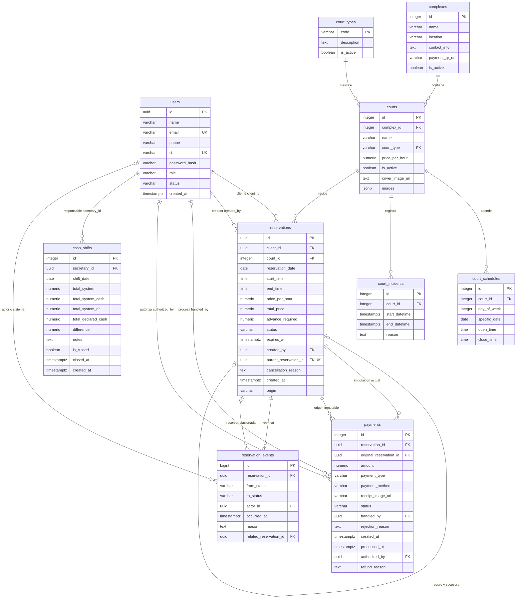

# Modelo de base de datos — SportReserva

Versión corregida para inspección formal, 24/09/2026. **Corregida en Supabase real y en el backend local.**

Hay diez tablas: ocho entidades operativas, un catálogo de deportes y un historial de eventos. La fuente ejecutable es [schema.sql](../back-canchas-deportivas/database/schema.sql), generada mediante `npm run db:schema`. El [diccionario completo](../back-canchas-deportivas/docs/inspeccion/diccionario-datos.md) se extrae del motor PostgreSQL y contiene todas las columnas, tipos, nulabilidad, valores predeterminados y restricciones.

Para una base existente se usa el [procedimiento de migración](../back-canchas-deportivas/docs/inspeccion/aplicacion-y-validacion.md), no el script completo de creación.

## Diagrama entidad-relación

`||`: exactamente uno; `o|`: cero o uno; `o{`: cero o muchos. La reserva padre tiene como máximo una sucesora directa; una cadena permite sucesivas reprogramaciones.

## Correspondencia con el negocio

Una reserva representa una contratación cliente–cancha. Resuelve esa N:M a lo largo del tiempo y agrega fecha, horario y precio pactado; no necesita otra tabla cliente_cancha. Cada pago tiene imputación actual y conserva su reserva de origen. Reprogramar mueve movimientos validados y devoluciones a la sucesora dentro de una transacción: no duplica ingresos ni sustituye dinero pagado por anticipo requerido.

Un horario corresponde a un día de semana **o** una fecha concreta. Las unicidades impiden varios horarios para la misma cancha/día o cancha/fecha; la excepción de fecha prevalece. El alcance actual no contempla horarios partidos ni reservas que crucen medianoche.

Los eventos guardan autor, instante, motivo y estados anterior/nuevo. Solo la expiración automática permite actor nulo. Pagos pendientes permiten responsable/fecha nulos; al procesar se registran. Devoluciones tienen motivo y autorizador propios, sin reutilizar rechazo/cancelación. El autorizador efectivo se toma del JWT, no de texto libre del cliente.

## Invariantes y operaciones atómicas

| Regla | Garantía PostgreSQL |
|---|---|
| Sin reservas superpuestas | Exclusión GiST `reservations_no_overlap`: rango `[inicio,fin)` y cancha; estados TEMPORAL, PENDING_VALIDATION, CONFIRMED y COMPLETED. |
| Expiración | `persist_reservation` expira bloqueos vencidos antes de insertar; cron complementario. NOW() no forma parte del índice. |
| Duración/importes | CHECK de horas enteras ≥1h, inicio :00/:30, importes positivos, total coherente y anticipo 25%. |
| Precio histórico | Trigger impide editar el contrato; cambios en courts afectan nuevas contrataciones. |
| Horarios/incidentes | Trigger valida horario especial/semanal, cancha/complejo activos e incidentes al insertar. |
| Comprobante | `submit_advance_receipt` guarda pago pendiente y cambia estado atómicamente. Storage se procesa antes. |
| Validación/rechazo | `process_advance` actualiza pago, reserva y evento en una transacción. |
| Reprogramación | `reschedule_reservation` cambia estado, crea sucesora y mueve imputación; errores revierten todo. |
| Ingreso | Suma neta de pagos ≥ precio; no basta con existir un pago llamado SALDO_FINAL. |
| Devoluciones | Monto ≤ neto disponible, responsable activo y autorización estructurada. |
| Cierre | Un cierre diario por responsable, cálculo neto por fecha de procesamiento y caja propia, inmovilidad posterior. |
| Actualización concurrente | Comparación de estado esperado: rechaza solicitudes obsoletas. |

Fechas/horas de reserva son comerciales de Bolivia. Auditoría, expiración, procesamiento e incidentes usan `timestamptz`; jornada en `America/La_Paz`. La migración interpreta como UTC timestamps anteriores escritos con `toISOString()`; confirmar procedencia si hubo importaciones manuales.

## Normalización y evolución

La [justificación de diseño](../back-canchas-deportivas/docs/inspeccion/normalizacion-y-decisiones.md) declara claves, dependencias y excepciones. Total y anticipo tienen redundancia controlada por CHECK; totales de caja son fotografías de cierre calculadas por trigger e inmutables. No se persiste saldo pendiente.

`court_types` permite nuevos deportes sin nuevas columnas. Estados operativos son vocabulario técnico cerrado: añadir uno exige revisar comportamiento y desplegar migración, no rediseñar entidades. El 25%, cinco minutos y cierre diario son requisitos explícitos; cambiarlos requiere versionar políticas y preservar contratos históricos.

La portada es una URL escalar opcional. El API conserva `images: []` de máximo un elemento por compatibilidad. La columna heredada images se conserva como espejo sincronizado de cero/una portada para compatibilidad; el trigger mantiene un único valor y evita galerías. Esta redundancia temporal está justificada y controlada.

## Acceso y archivos

NestJS usa JWT propio y controla roles/propiedad. Las diez tablas tienen RLS; tablas/RPC no permiten acceso directo de `anon`/`authenticated`. El backend usa `service_role`, nunca Angular. Los RPC usan SECURITY INVOKER. Las políticas y funciones se verificaron en el proyecto real; el asesor de seguridad no reportó hallazgos.

Se mantienen `payment-receipts` (privado) y `complex-qrs` (público). La migración no elimina archivos ni cambia políticas de Storage.

## Evidencias

- [HU → modelo](../back-canchas-deportivas/docs/inspeccion/trazabilidad-historias.md).
- [Diccionario físico](../back-canchas-deportivas/docs/inspeccion/diccionario-datos.md).
- [Resultado y pendientes](08-inspeccion-formal-base-datos.md).
- `npm run test:database` y `npm test -- --runInBand`.
