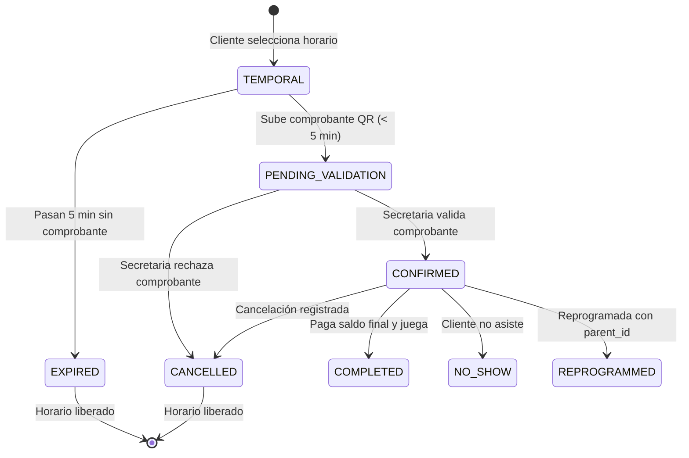

# 📋 Reglas de Negocio e Invariantes del Sistema

Este documento define de forma exhaustiva e inequívoca las **reglas de negocio**, validaciones matemáticas, políticas de servicio y máquinas de estado del sistema. Cualquier agente de IA o desarrollador que modifique la lógica de aplicación debe garantizar el cumplimiento estricto de estos invariantes.

---

## 1. Reglas de Duración y Selección de Horarios

### Regla RN-01: Duración en bloques de media hora (09/10/2026)
- Duración mínima: 30 minutos.
- Se permiten múltiplos de 30 minutos: 30, 60, 90, 120 minutos, etc.
- El total se calcula con la tarifa por hora congelada, multiplicada por la duración real y redondeada a dos decimales.

### Regla RN-02: Hora de inicio y fin
Ambos extremos deben estar en minuto :00 o :30 y el fin debe ser posterior al inicio dentro de la misma jornada.
- Permitidos: 08:00–08:30, 08:30–10:00, 19:00–21:00.
- Prohibidos: 08:15–08:45, duraciones menores de 30 minutos, rangos invertidos.

---

## 2. Bloqueo Temporal de 5 Minutos

### Regla RN-03: Bloqueo Anti-Colisión (5 Minutos)
1. Cuando un cliente autenticado selecciona un horario disponible, el sistema genera inmediatamente un registro en `reservations` con estado `TEMPORAL`.
2. El campo `expires_at` se establece en:
   $$\text{expires\_at} = \text{CURRENT\_TIMESTAMP} + \text{INTERVAL '5 minutes'}$$
3. Mientras `status = 'TEMPORAL'` y `NOW() < expires_at`, ningún otro usuario puede ver ni seleccionar ese bloque horario.
4. El cliente dispone de un cronómetro visible en pantalla de **5 minutos regresivos**.
5. Al adjuntar el comprobante de pago:
   - `reservations.status` pasa a `PENDING_VALIDATION`.
   - Se congela el temporizador de expiración (el horario queda reservado a la espera de la secretaria).
6. Si transcurren los 5 minutos sin comprobante:
   - La reserva pasa a `EXPIRED`.
   - El horario se libera inmediatamente para que cualquier otro cliente pueda reservarlo.

---

## 3. Tarifas, Anticipo (25%) e Inmutabilidad Histórica

### Regla RN-04: Cálculo Matemático del Anticipo y Saldo
El sistema calcula los montos según las siguientes fórmulas (redondeo a 2 decimales):

$$\text{total\_price} = \text{duration\_hours} \times \text{court.price\_per\_hour}$$
$$\text{advance\_required} = \text{round}(\text{total\_price} \times 0.25, 2)$$
$$\text{pending\_balance} = \text{total\_price} - \text{advance\_paid}$$

#### Ejemplo Numérico:
- Precio por hora de la cancha: **Bs 100.00**
- Horario reservado: `18:30 -> 20:30` (2 horas)
- **Precio Total**: $2 \times 100 = \text{Bs } 200.00$
- **Anticipo Requerido (25%)**: $200 \times 0.25 = \text{Bs } 50.00$
- **Saldo Pendiente**: $200 - 50 = \text{Bs } 150.00$

### Regla RN-05: Inmutabilidad del Precio Histórico
- Al momento de crearse una reserva, se copia el valor de `courts.price_per_hour` en `reservations.price_per_hour`.
- Si un Administrador modifica posteriormente el precio de la cancha (por ejemplo, aumentando de Bs 100/h a Bs 120/h):
  - Las nuevas reservas tomarán el nuevo precio (Bs 120/h).
  - **Las reservas ya existentes conservarán inalterado su precio original pactado** (Bs 100/h).

---

## 4. Validación de Anticipos (Rol Secretaria)

### Regla RN-06: Verificación Humana del Comprobante
1. El sistema no realiza integración bancaria automática en su primera versión. La validación es realizada por la Secretaria/Cajera.
2. Al revisar un comprobante:
   - **Si el pago es legítimo**:
     - `payments.status = 'VALIDATED'`
     - `payments.handled_by = secretary.id`
     - `reservations.status = 'CONFIRMED'`
   - **Si el comprobante es inválido / ilegible / adulterado**:
     - `payments.status = 'REJECTED'`
     - `payments.handled_by = secretary.id`
     - `payments.rejection_reason` (obligatorio, ej. "Monto insuficiente", "Comprobante falso o duplicado")
     - `reservations.status = 'CANCELLED'` y el horario vuelve a liberarse.

---

## 5. Control de Acceso Físico y Pago del Saldo Restante

### Regla RN-07: Prohibición de Ingreso sin Pago del 100%
1. El anticipo del 25% solo otorga derecho a apartar la cancha.
2. **Ningún cliente puede ingresar a la cancha si tiene saldo pendiente** (`pending_balance > 0`).
3. Al presentarse en recepción:
   - La secretaria consulta la reserva y el saldo pendiente.
   - Cobra los Bs restantes (en `EFECTIVO` o `QR`).
   - Registra el registro en `payments` con `payment_type = 'SALDO_FINAL'`, `status = 'VALIDATED'`, `handled_by = secretary.id`.
   - Cuando la suma de pagos validados alcanza el `total_price`, el sistema habilita el botón de autorización de ingreso a cancha.

---

## 6. Políticas de Cancelación y Reprogramación

### Regla RN-08: Política de Anticipo No Reembolsable
- **Principio General**: Por política comercial del establecimiento, el anticipo del 25% **no es reembolsable** en cancelaciones voluntarias del cliente.
- El cliente debe ser advertido explícitamente de esta política antes de subir el comprobante (HU-CLI-22).

### Regla RN-09: Excepciones de Devolución Autorizadas
- Cuando la administración o secretaría autorice una excepción justificada (ej. fuerza mayor, calamidad comprobada):
  - Se registra formalmente en el sistema como **Excepción Autorizada** con `payments.authorized_by`, `payments.refund_reason` y `payments.processed_at`. La identidad autorizadora procede del JWT.

### Regla RN-10: Reprogramaciones
- La reprogramación **nunca es automática** para el cliente: requiere gestión de la secretaría (HU-CLI-23, HU-SEC-20).
- Al reprogramar:
  1. Se marca la reserva original con estado `REPROGRAMMED`.
  2. Se crea una nueva reserva con la nueva fecha y hora.
  3. Se establece `new_reservation.parent_reservation_id = old_reservation.id`.
  4. Los movimientos validados y devoluciones se imputan a la sucesora mediante una transacción. `payments.original_reservation_id` conserva la procedencia; `reservation_id` representa la imputación actual. El anticipo requerido se recalcula según el contrato nuevo y no representa dinero recibido.

---

## 7. Gestión de Inasistencias (*No-Show*)

### Regla RN-11: Criterio Humano en Inasistencias
- Si un horario reservado y confirmado comienza y el cliente no ha llegado:
  - El sistema **NO libera la cancha de forma automática** (el cliente podría estar retrasado 10 o 15 minutos).
  - La secretaria tiene la potestad en su panel de marcar la reserva como `NO_SHOW` y decidir el momento exacto en el que libera el horario para un tercero (HU-SEC-17, HU-SEC-18).
  - Queda trazabilidad de quién liberó la cancha y a qué hora en `reservation_events(actor_id, occurred_at, from_status, to_status, reason)`.

---

## 8. Canchas Inhabilitadas y Mantenimiento

### Regla RN-12: Bloqueo de Disponibilidad por Incidentes
- Todo registro en `court_incidents` con rango `start_datetime` a `end_datetime`:
  - Inhabilita de inmediato la disponibilidad pública de la cancha en esas fechas y horas.
  - Alerta a la secretaría y al administrador con la lista de reservas confirmadas afectadas (HU-SEC-22, HU-ADM-12).
  - Permite a la secretaria contactar a los clientes por teléfono/email para ofrecer reprogramación prioritaria sin pérdida de su anticipo.

---

## 9. Control de Caja y Arqueo Diario

### Regla RN-13: Cuadre de Caja de Secretaria

Un cierre por secretaria y fecha comercial en America/La_Paz:

- total_system_cash: cobros validados en efectivo menos devoluciones en efectivo de esa secretaria, por fecha de procesamiento.
- total_system_qr: cobros validados QR menos devoluciones QR del mismo responsable/jornada.
- total_system: total_system_cash + total_system_qr.
- total_declared_cash: efectivo contado físicamente.
- difference: total_declared_cash - total_system_cash.

El servidor calcula los totales dentro de la transacción del cierre. Nunca sustituye una caja vacía por cobros de otra persona. El cierre es inmutable y no acepta nuevos movimientos de la misma secretaria/jornada después de su cierre. Los eventos de validación antiguos sin fecha no se reconstruyen ficticiamente.
