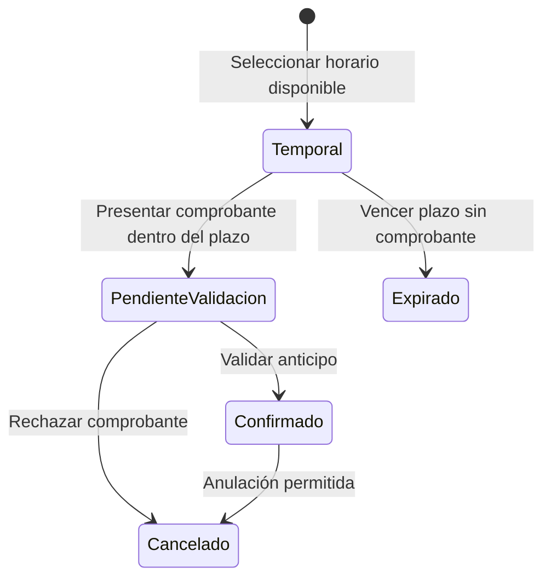

# EC3 — Plan de trabajo y reparto del equipo

**Proyecto:** SportReserva — Sistema de Gestión y Reservas de Canchas Deportivas  
**Entrega:** 20 de noviembre de 2026  
**Fecha de preparación del plan:** 17 de noviembre de 2026  
**Estado:** guía de planificación; no constituye evidencia de pruebas ejecutadas.

**Herramienta elegida por el equipo: Playwright con TypeScript.** Consultar el [desglose operativo completo](EC3-guia-operativa-playwright.md) para configuración, tareas por bloque, automatización, evidencias y cierre. La comparación con IntelliTest se conserva solamente como antecedente.

**Avance de Mateo:** recorrido elegido = reserva del cliente. Configuración y 27 casos implementados; consultar [diseño y cobertura](ec3/mateo/diseno-y-cobertura.md) y [resultados reales](ec3/mateo/resultado-ultima-ejecucion.md). El tablero general conserva las tareas del equipo: no debe interpretarse como evidencia de ejecución de los otros integrantes.

## 1. Qué debemos entregar

El objetivo es demostrar, mediante pruebas funcionales automatizadas de caja negra, que el proceso principal y la creación de Cancha y Complejo cumplen sus reglas. Se debe conectar cada requisito con su diseño de prueba, su ejecución y su evidencia.

La entrega tiene cuatro componentes:

1. Sistema funcionando con el proceso comprometido.
2. Casos diseñados con partición de equivalencias (EP), análisis de valores límite de tres valores (BVA 3), transición de estados y tablas de decisión.
3. Automatización y resultados reales: ejecutadas, aprobadas y fallidas.
4. Informe final en PDF con los ocho apartados del enunciado y repositorios accesibles al docente.

La rúbrica asigna 35 puntos al documento, 20 al software, 35 a la automatización y 10 a la defensa. No conviene dejar la documentación ni la automatización para el último día.

“Completo” significa cubrir los requisitos y justificar la cobertura. No significa garantizar una nota ni demostrar ausencia absoluta de defectos.

## 2. Alcance acordado con el docente

| Área | Compromiso | Evidencia que debe existir |
| --- | --- | --- |
| Proceso principal | Reserva completa, pago completo/total y anulación de la reserva | Recorridos automatizados con resultados observables |
| Tabla 1 | Cancha, solamente Crear | EP, BVA aplicable y ejecución |
| Tabla 2 | Complejo, solamente Crear | EP, BVA aplicable y ejecución |
| Estados | Pendiente de validación, Confirmado, Expirado y Cancelado | Modelo de estados y pruebas de transiciones válidas e inválidas |
| Decisión | Cancha, horario disponible y pago confirmado | Condiciones precisas, reglas, acciones y casos |

No se exige probar Editar y Eliminar de las dos tablas. Consultar el registro creado sí es útil para comprobar que Crear funcionó.

Reprogramaciones, reportes gerenciales, cierres de caja y otros módulos no se agregan como objetivos independientes de EC3. Una dependencia necesaria para preparar o ejecutar el flujo puede utilizarse sin convertir todo ese módulo en otro alcance de pruebas.

### 2.1 Dos aclaraciones fundamentales antes de diseñar

La documentación local describe estas reglas; deben contrastarse con la versión que se presentará:

- El bloqueo empieza en `TEMPORAL`. Sin comprobante dentro del plazo, pasa a `EXPIRED`.
- Al presentar el comprobante pasa a `PENDING_VALIDATION`; la documentación indica que deja de expirar por el temporizador inicial.
- La validación del anticipo permite pasar a `CONFIRMED`.
- El pago del saldo completa el total; confirmar la reserva y pagar el 100% son hechos diferentes.

Por tanto, **no se debe inventar una transición Pendiente de validación → Expirado para encajar cuatro estados**. El modelo puede incluir Temporal como estado adicional: la consigna exige al menos tres estados, no exactamente cuatro. Conviene explicar esta ampliación al docente como fidelidad al flujo existente.

Igualmente, “reserva completa con pago total” puede demostrarse mediante anticipo más saldo, si ese es el recorrido acordado. No implica que el sistema deba permitir pagar todo en una sola operación. Si se comprometió pago único del 100%, se debe verificar expresamente esa modalidad.

Estas precisiones corrigen el carácter provisional de los ejemplos de la explicación inicial. Las reglas del informe deben representar requisitos acordados, y las diferencias observadas en la aplicación deben registrarse como discrepancias, no aceptarse automáticamente como correctas.

## 3. Herramienta y tipo de pruebas

### 3.1 Herramienta elegida: Playwright

El proyecto utiliza Angular y NestJS con TypeScript. Playwright permite ejecutar acciones desde el navegador y comprobar resultados visibles. Además, el enunciado lo considera un plus.

La propuesta es ejecutar pruebas funcionales de sistema de extremo a extremo sobre un entorno de pruebas, con frontend y backend reales. Los datos de preparación pueden cargarse mediante mecanismos controlados; las acciones centrales que se quieren demostrar deben ejercitar la aplicación.

Utilizar un reporte HTML para la revisión y JSON o JUnit si resulta útil para consolidar resultados. Conservar capturas, y trazas o videos cuando ayuden a explicar fallos.

### 3.2 ¿Sirve IntelliTest?

Si se trata de Microsoft IntelliTest, no es la herramienta apropiada: genera pruebas unitarias a partir del código .NET, mientras que SportReserva usa TypeScript y EC3 exige diseño de caja negra. Microsoft indica que IntelliTest está en desuso en Visual Studio 2026; en Visual Studio 2022 se limita a .NET Framework y Visual Studio Enterprise.

Si “Intelli Test” se refiere a otro producto, esta conclusión no lo evalúa: habría que identificar su nombre y documentación.

### 3.3 ¿Se necesitan pruebas de integración adicionales?

No aparecen como un entregable separado en la consigna. Una suite funcional de extremo a extremo puede cubrir lo pedido, aunque durante su ejecución intervengan conjuntamente varios componentes.

| Concepto | Aplicación en EC3 |
| --- | --- |
| Caja negra | Diseñar desde reglas, entradas y resultados; no desde ramas internas del código |
| Funcional | Comprobar el comportamiento requerido |
| Sistema/extremo a extremo | Recorrer la aplicación y comprobar el resultado completo |
| Integración | Evaluar específicamente interfaces entre componentes; no se solicita una batería independiente |
| Unitaria | Probar unidades aisladas; puede complementar, pero no reemplaza la evidencia funcional |

No se debe presentar una suite con todas las respuestas del backend simuladas como demostración del proceso completo real. Tampoco reutilizar conteos de ejecuciones antiguas como si correspondieran a la versión final.

## 4. Primera actividad conjunta: cerrar las reglas

Antes de dividir la implementación, realizar una reunión breve y completar esta tabla. Un integrante mantiene el registro, pero las decisiones son del equipo.

| Pregunta | Acuerdo por completar | Responsable |
| --- | --- | --- |
| ¿Qué recorrido demuestra la reserva: cliente, manual o ambos? | Pendiente | Por asignar |
| ¿Pago total mediante anticipo + saldo o también pago único? | Pendiente | Por asignar |
| ¿Qué evento inicia el plazo de expiración? | Contrastar documentación y aplicación | Por asignar |
| ¿Qué estados permiten anular y con qué rol? | Pendiente | Por asignar |
| ¿Qué sucede con el horario y los pagos tras anular? | Pendiente | Por asignar |
| ¿Qué significa exactamente “cancha” en la tabla de decisión? | Propuesta: cancha habilitada para el intervalo | Por asignar |
| ¿Qué pago evalúa la tabla: anticipo o total? | Pendiente | Por asignar |
| ¿En qué momento se evalúa la decisión? | Pendiente | Por asignar |
| ¿Cuáles son los límites y obligatoriedad de cada campo? | Levantar por formulario | Por asignar |

No añadir condiciones de cuenta verificada por suposición. El acceso puede prepararse con cuentas de prueba existentes. Si login o registro forman parte del recorrido elegido, documentar expresamente su inclusión y sus formularios.

## 5. Inventario de formularios

Esta lista es una guía de levantamiento, no un inventario validado de las pantallas actuales. Cada responsable debe indicar la ruta real, el rol, los campos y las reglas.

| ID | Formulario o interacción | Qué revisar | Alcance |
| --- | --- | --- | --- |
| F01 | Selección de cancha, fecha y horario | Cancha seleccionada, disponibilidad, duración, intervalos, total calculado | Principal |
| F02 | Datos de reserva | Campos solicitados al cliente o al operador | Principal, según recorrido |
| F03 | Registro/presentación de pago | Importe si es editable, método, comprobante y campos obligatorios | Principal |
| F04 | Validación o rechazo del pago | Acción, motivo si existe, cambio de estado | Principal |
| F05 | Cobro de saldo/pago total | Saldo, monto admitido, método, resultado | Principal |
| F06 | Anulación | Rol, estado, confirmación y motivo si existe | Principal |
| F07 | Crear Complejo | Todos los campos realmente existentes y sus reglas | Crear |
| F08 | Crear Cancha | Todos los campos existentes, complejo asociado y reglas | Crear |

Si una interacción solo tiene botones y no campos con límites, documentar sus opciones y precondiciones. No inventar BVA numérico para cumplir una tabla.

Si existen dos formularios diferentes dentro del recorrido comprometido, ambos deben quedar cubiertos. No basta con probar uno porque ambos terminan creando una reserva.

## 6. Diseño de EP y BVA 3

### 6.1 Pasos por formulario

1. Registrar los campos y sus reglas de negocio.
2. Identificar clases válidas e inválidas por campo.
3. Elegir datos representativos para cada clase.
4. Identificar fronteras ordenadas: longitud, monto, fecha, duración, tamaño de archivo, etc.
5. Elegir tres valores por frontera: anterior, frontera y posterior.
6. Definir precondiciones y resultados esperados observables.
7. Mantener válidos los otros campos cuando se evalúe un dato inválido.
8. Asociar cada caso a su automatización y evidencia.

### 6.2 Plantilla de particiones

| Campo | Regla y fuente | Clase | Válida/inválida | Dato representativo | Resultado esperado | Caso |
| --- | --- | --- | --- | --- | --- | --- |
| Por completar | Por completar | EP-01 | Por completar | Por completar | Por completar | EP-F07-001 |

Para una selección de complejo pueden existir clases como seleccionado válido y ausencia de selección. Un identificador inexistente enviado directamente a la API sería un caso de esa interfaz; no debe fingirse que puede introducirse por un selector de navegador que no lo permite.

### 6.3 Plantilla de BVA

| Campo | Frontera | Unidad/precisión | Anterior | En frontera | Posterior | Resultado por valor | Casos |
| --- | --- | --- | --- | --- | --- | --- | --- |
| Por completar | Por completar | Por completar | Por completar | Por completar | Por completar | Por completar | BVA-F07-001… |

Ejemplo didáctico, no límite confirmado del sistema: si un nombre admite de 3 a 50 caracteres, usar 2/3/4 y 49/50/51. No basta probar solamente 3 y 50.

Para dinero con dos decimales, los vecinos de Bs 100 serían Bs 99,99 y Bs 100,01 cuando esa sea la frontera de la regla. El resultado depende de si el sistema exige igualdad, acepta pagos parciales o admite excedentes: acordar la regla primero.

Para tiempo, explicitar la resolución y la interfaz. En un selector que solo permite bloques de 30 minutos no se puede introducir normalmente 29 minutos. Se puede comprobar que la selección inválida no está disponible y, si se decide cubrir también la API, registrar esa comprobación como funcional de API. No declarar ejecutado un dato que el test nunca introdujo.

Los campos categóricos, como un método de pago, normalmente admiten EP pero no BVA. Indicar “No aplica: dominio sin frontera ordenada”.

### 6.4 Plantilla completa de caso

```text
ID: EP-F07-001
Título:
Requisito/regla y fuente:
Técnica: EP / BVA 3 / Estados / Decisión
Clase, frontera, transición o regla cubierta:
Rol:
Precondiciones:
Datos:
Pasos:
Resultado esperado:
Limpieza de datos, si corresponde:
Prueba automatizada asociada:
Resultado obtenido: pendiente de ejecución
Estado: diseñado / automatizado / aprobado / fallido / bloqueado
Evidencia:
Defecto asociado, si corresponde:
Responsable y revisor:
```

No hay un número universal de casos suficiente. Se calcula desde las clases, fronteras, transiciones y reglas identificadas. Un caso puede cubrir varios elementos si se registra la trazabilidad; no debe mezclar varias entradas inválidas y luego atribuir el rechazo a todas ellas.

## 7. Transición de estados de la reserva

### 7.1 Justificación para el informe

La reserva es adecuada porque su comportamiento depende del estado previo. Una misma acción, como confirmar un pago o anular, puede estar permitida o prohibida según ese estado. Además, los cambios afectan la disponibilidad del horario y el seguimiento de pagos.

### 7.2 Modelo de referencia

Este diagrama resume la documentación local consultada. No constituye verificación del comportamiento ejecutado. Las transiciones adicionales y las condiciones exactas de anulación deben contrastarse antes de cerrar los casos.



La prueba del pago total se mantiene en el proceso principal aunque no provoque una transición entre estos estados. No confundir el estado de la reserva con el estado del pago. Si el recorrido incluye autorización de ingreso y un estado adicional, documentarlo sin atribuir automáticamente ese cambio al cobro.

### 7.3 Casos a desarrollar

| ID propuesto | Estado inicial | Evento | Resultado de referencia |
| --- | --- | --- | --- |
| TE-001 | Temporal | Presentar comprobante válido dentro del plazo | Pendiente de validación |
| TE-002 | Temporal | Vencer plazo sin comprobante | Expirado y horario liberado |
| TE-003 | Pendiente de validación | Validar anticipo | Confirmado |
| TE-004 | Pendiente de validación | Rechazar comprobante con requisitos completos | Cancelado; comprobar efectos previstos |
| TE-005 | Confirmado | Anular bajo las condiciones permitidas | Cancelado; comprobar efectos previstos |
| TE-006 | Cancelado | Intentar confirmar otra vez | Rechazo y estado sin cambios, según regla acordada |
| TE-007 | Expirado | Intentar presentar/validar pago fuera de plazo | Rechazo según regla; no reactivar silenciosamente |
| TE-008 | Pendiente de validación | Superar el plazo original tras presentar comprobante | No expirar por el temporizador inicial, según documentación |

Para cada transición comprobar el estado final y el efecto observable relevante. Una captura de una reserva ya cancelada no demuestra que la acción de anulación funcionó.

La expiración requiere controlar el tiempo del sistema que decide el vencimiento. Cambiar solamente el reloj del navegador no acelera automáticamente el backend. Definir una espera real o un mecanismo de prueba documentado; no marcar directamente la reserva como expirada y afirmar que se probó la expiración.

## 8. Tabla de decisión

### 8.1 Definir condiciones y momento

“Cancha” debe convertirse en una pregunta verificable. Una propuesta es:

- C1: ¿La cancha está habilitada para el intervalo solicitado?
- C2: ¿El horario está disponible para esta operación?
- C3: ¿El pago requerido para esta operación está confirmado?

Definir si C3 significa anticipo validado o total pagado. Si se evalúa confirmar una reserva, no exigir el 100% cuando el requisito permite confirmar con anticipo. Si se evalúa permitir el uso de la cancha, el pago total puede ser relevante, pero el significado de disponibilidad debe ajustarse a ese momento.

El horario retenido por la propia reserva no debe confundirse con un conflicto de otra reserva.

### 8.2 Tabla inicial de análisis, no resultados aprobados

| Regla | C1 | C2 | C3 | Acción por definir según el momento elegido |
| --- | --- | --- | --- | --- |
| R1 | Sí | Sí | Sí | Permitir la operación si se cumplen las demás precondiciones |
| R2 | Sí | Sí | No | Impedir confirmación o mantener pendiente, según la operación |
| R3 | Sí | No | Sí | Impedir la operación por conflicto; definir tratamiento del pago |
| R4 | Sí | No | No | Impedir por indisponibilidad |
| R5 | No | Sí | Sí | Impedir por inhabilitación; definir tratamiento del pago |
| R6 | No | Sí | No | Impedir por inhabilitación |
| R7 | No | No | Sí | Impedir; documentar prioridad del mensaje y tratamiento del pago |
| R8 | No | No | No | Impedir; documentar prioridad del mensaje |

Esta tabla enumera las ocho combinaciones teóricas; no afirma que todas sean alcanzables. Algunas pueden corresponder a un cambio posterior de disponibilidad y otras ser imposibles en el flujo elegido.

El responsable debe:

1. Elegir un único punto de decisión coherente con las tres condiciones comprometidas.
2. Convertir las acciones anteriores en resultados exactos, sin alternativas ambiguas.
3. Identificar reglas alcanzables e imposibles y justificar las exclusiones.
4. Agrupar reglas equivalentes usando “—” cuando una condición sea irrelevante.
5. Conservar al menos tres combinaciones relevantes, como pide la consigna.
6. Crear un caso por regla relevante y definir cómo preparar sus precondiciones.

Si no se encuentran tres combinaciones alcanzables con esas condiciones en el punto elegido, ajustar la definición del flujo con el equipo y explicar el ajuste al docente; no fabricar evidencia.

## 9. Automatización y evidencias

### 9.1 Preparación compartida

- Entorno de pruebas identificado, con versiones de frontend y backend.
- Cuentas de cliente, secretaria y administrador, según el recorrido.
- Complejo y cancha disponibles como datos base para reservas.
- Fechas y horarios controlados usando America/La_Paz como referencia comercial.
- Comprobantes sintéticos sin datos bancarios personales.
- Estrategia para no reutilizar el mismo horario en casos paralelos.
- Datos propios de cada prueba y limpieza limitada a esos datos.
- Comando de ejecución y ubicación de los reportes documentados.

### 9.2 Organización sugerida, todavía no creada

```text
e2e/
  fixtures/                 # Cuentas y preparación compartida
  helpers/                  # Acciones reutilizables
  complejos.spec.ts
  canchas.spec.ts
  reservas-formularios.spec.ts
  reservas-pagos.spec.ts
  reservas-estados.spec.ts
  reservas-decision.spec.ts
docs/ec3/
  diseno/                   # Casos, reglas y trazabilidad
  resultados/               # Resúmenes de ejecuciones
  evidencias/               # Capturas y referencias a reportes
  informe/                  # Fuente del informe y PDF final
```

Acordar en qué repositorio vivirá la suite. Esta estructura es una propuesta; el presente plan no instala Playwright ni crea pruebas.

### 9.3 Reglas de implementación

- Incluir el ID del caso en el nombre de la prueba.
- Comprobar resultados con aserciones; hacer clic sin verificar no basta.
- Comprobar persistencia mediante recarga o consulta visible cuando sea relevante.
- Evitar que un test dependa de que otro haya pasado previamente.
- Usar datos distintos para casos que puedan ejecutarse simultáneamente.
- No ocultar fallos con reintentos; reportar pruebas inestables por separado.
- Guardar la versión o commit, fecha, entorno y comando de cada corrida final.
- La revisión de requisitos orienta el diseño; leer el código sirve para contrastar implementación, no para sustituir el resultado esperado de negocio.

### 9.4 Registro de ejecución

| Ejecución | Fecha/hora | Versión | Diseñados | Ejecutados | Pasaron | Fallaron | Omitidos/bloqueados | Reporte |
| --- | --- | --- | --- | --- | --- | --- | --- | --- |
| EJ-001 | Pendiente | Pendiente | Pendiente | Pendiente | Pendiente | Pendiente | Pendiente | Pendiente |

Separar casos lógicos de intentos y de ejecuciones por navegador. Si hay 40 casos en tres navegadores, pueden aparecer 120 ejecuciones; no presentarlas como 120 casos diferentes. Los reintentos tampoco son nuevos casos diseñados.

Una prueba negativa pasa cuando el sistema rechaza correctamente una entrada inválida. No es obligatorio que haya fallos en la corrida final; si los hay, deben explicarse sin alterar los resultados.

### 9.5 Registro de defectos

| ID | Caso | Esperado | Obtenido | Impacto | Evidencia | Responsable | Estado | Reprueba |
| --- | --- | --- | --- | --- | --- | --- | --- | --- |
| DEF-001 | Por completar | Por completar | Por completar | Por completar | Por completar | Por asignar | Pendiente | Pendiente |

Conservar la corrida inicial y la posterior a la corrección. Distinguir un defecto del producto de un problema del test, de datos o del entorno.

## 10. Reparto acordado: Mateo, Ostin, Marcelo y Robert

Mateo, Ostin y Marcelo diseñan, automatizan y ejecutan sus pruebas. Robert se encarga de la documentación, la trazabilidad y el PDF final. Los responsables técnicos entregan a Robert sus casos, resultados y evidencias; Robert no tiene asignada programación de pruebas.

| Integrante | Responsabilidad principal | Entregables concretos | Revisor |
| --- | --- | --- | --- |
| Mateo | Formularios de reserva, configuración de Playwright y transición de estados | Inventario F01/F02, EP/BVA, casos TE, tests, ejecución consolidada y evidencias | Ostin |
| Ostin | Pago, saldo total y anulación | Inventario F03–F06, EP/BVA aplicable, tests de pago/anulación y evidencias; apoyo a estados y decisiones | Mateo |
| Marcelo | Crear Complejo, Crear Cancha y tabla de decisión | Inventario F07/F08, EP/BVA, casos TD, tests y evidencias; validación técnica de diagramas | Mateo |
| Robert | Documentación completa | Ocho apartados del informe, diagramas presentables, tablas, trazabilidad, capturas comentadas, anexos y PDF final | Todo el equipo |

Mateo prepara la infraestructura mínima; Ostin y Marcelo contribuyen con sus suites. Robert comienza el informe desde el inicio y solicita los insumos faltantes. Si la configuración consume más tiempo de lo previsto, Ostin ayuda a Mateo.

### 10.1 Límites para evitar trabajo duplicado

- Ostin comprueba los campos y el recorrido de pago; Mateo coordina las transiciones y Marcelo las reglas de decisión.
- Si una prueba de Ostin ya demuestra una transición o regla de decisión, se reutiliza con doble trazabilidad en vez de duplicar la automatización. Robert registra esa relación en el informe.
- Marcelo mantiene los casos de creación; Mateo y Ostin pueden usar datos base preparados sin ejecutar todos los formularios de creación en cada test.
- Mateo y Robert acuerdan una sola convención de IDs, carpetas y reportes.
- Cada archivo compartido tiene un responsable de integración para reducir conflictos.

### 10.2 Qué debe recibir Robert de cada compañero

- De Mateo: entorno y comandos, explicación de reserva, EP/BVA, modelo y casos de estados, tests asociados, capturas y reporte consolidado.
- De Ostin: reglas de anticipo/saldo/anulación, EP/BVA aplicable, casos y tests, capturas, resultados y defectos de pagos.
- De Marcelo: EP/BVA de Complejo/Cancha, tabla de decisión cerrada, casos y tests, capturas y validación técnica de los diagramas.
- De los tres: versión ejecutada, resultado esperado/obtenido, dificultades reales y conclusiones de su bloque.

Robert revisa que esos insumos coincidan, redacta y organiza los ocho apartados, mantiene la matriz de trazabilidad, prepara los diagramas y exporta/revisa el PDF. Devuelve a cada responsable las dudas técnicas; no inventa resultados ni reglas para completar espacios.

## 11. Tablero de tareas para asignar

| ID | Tarea | Responsable sugerido | Depende de | Se considera terminada cuando | Estado |
| --- | --- | --- | --- | --- | --- |
| T01 | Cerrar alcance, reglas y recorridos | Todos | — | Acuerdos escritos y ambigüedades resueltas | Pendiente |
| T02 | Inventariar formularios y límites | Mateo/Ostin/Marcelo | T01 | Campos y reglas con fuentes | Pendiente |
| T03 | Preparar entorno y suite mínima | Mateo, apoyo del equipo | T01 | Un recorrido real ejecutable y reporte visible | Pendiente |
| T04 | Diseñar EP/BVA de reserva | Mateo | T02 | Casos revisados por Ostin | Pendiente |
| T05 | Diseñar EP/BVA de pagos/anulación | Ostin | T02 | Casos revisados por Mateo | Pendiente |
| T06 | Diseñar EP/BVA de Cancha/Complejo | Marcelo | T02 | Casos revisados por Mateo | Pendiente |
| T07 | Diseñar estados y casos | Mateo, apoyo de Ostin | T01 | Transiciones y eventos precisos | Pendiente |
| T08 | Cerrar tabla de decisión y casos | Marcelo, apoyo de Ostin | T01 | Acciones exactas y ≥3 combinaciones relevantes | Pendiente |
| T09 | Automatizar cada bloque | Mateo/Ostin/Marcelo | T03 y diseño correspondiente | Casos vinculados y aserciones verificables | Pendiente |
| T10 | Preparar y revisar diagramas del informe | Robert; Marcelo valida | T01 | Diagramas legibles y consistentes con versión entregada | Pendiente |
| T11 | Ejecutar suite consolidada | Mateo; Ostin y Marcelo apoyan | T09 | Conteos y evidencias reales conservados y enviados a Robert | Pendiente |
| T12 | Corregir defectos y repetir casos afectados | Dueño del módulo | T11 | Resultado de reprueba documentado | Pendiente |
| T13 | Redactar secciones y consolidar PDF | Robert; recibe insumos de los tres | T10/T11/T12 | Ocho apartados y trazabilidad completa | Pendiente |
| T14 | Verificar repositorios e instrucciones | Mateo y Robert | T13 | Acceso y reproducción comprobados | Pendiente |
| T15 | Ensayar defensa y revisar PDF | Todos | T13/T14 | Flujo, técnicas y resultados explicables | Pendiente |

## 12. Cronograma propuesto hasta el 20/11/2026

Fechas locales de Bolivia. Confirmar la hora exacta de entrega; no está indicada en el enunciado compartido.

| Fecha | Prioridad | Resultado al terminar |
| --- | --- | --- |
| 17/11 | Reglas, reparto, inventario y entorno | Alcance cerrado, responsables asignados y primer test ejecutable |
| 18/11 | Diseño revisado y automatización por bloques | EP/BVA/TE/TD trazables y avance funcional de la suite |
| 19/11 | Corrida completa, correcciones y evidencias | Reporte consolidado, defectos registrados y borrador del PDF |
| 20/11, antes del cierre | Verificación final, PDF y ensayo | Entrega accesible y demostración preparada |

Si el tiempo se reduce, priorizar el alcance obligatorio y simplificar presentación o utilidades auxiliares. No reemplazar pruebas pendientes por resultados inventados ni ampliar módulos opcionales antes de cubrir lo comprometido.

## 13. Estructura del informe PDF y aportes

| Apartado obligatorio | Contenido mínimo concreto | Aporte sugerido |
| --- | --- | --- |
| 1. Portada | Proyecto, integrantes, docente, asignatura y fecha | Robert reúne datos de todos |
| 2. Introducción | Propósito de SportReserva, problema y objetivo de calidad | Robert redacta; Mateo aporta contexto |
| 3. Diseño inicial | Modelo relacional y diagramas de clases legibles | Robert prepara; Marcelo valida técnicamente |
| 4. Desarrollo | Recorrido de reserva, anticipo, saldo y anulación; roles | Robert redacta con insumos de Mateo/Ostin |
| 5. Diseño de pruebas | EP/BVA por formulario, justificación y casos de estados y decisión | Robert integra los diseños de Mateo/Ostin/Marcelo |
| 6. Ejecución | Entorno, versión, comando, capturas, conteos e interpretación | Todos; Robert consolida |
| 7. Conclusiones | Hallazgos reales, dificultades, limitaciones y aprendizajes | Robert redacta con reflexiones de todos |
| 8. Anexos | Repositorios, acceso a reportes, matriz completa e instrucciones | Mateo/Robert |

Si el diseño inicial difiere de la versión final, explicar los cambios. No presentar diagramas antiguos como descripción exacta del sistema actual.

Cada captura debe tener pie: ID de caso o ejecución, acción mostrada y resultado. El PDF debe contener la evidencia y explicación esenciales; los enlaces complementan el documento, no sustituyen su contenido mínimo.

### 13.1 Matriz de trazabilidad

| Requisito | Formulario/flujo | Técnica | Caso | Archivo y nombre del test | Ejecución | Evidencia | Resultado |
| --- | --- | --- | --- | --- | --- | --- | --- |
| Por completar | Por completar | EP/BVA/TE/TD | Por completar | Por completar | Por completar | Por completar | Pendiente |

Esta matriz permite detectar requisitos sin casos, casos sin automatización y pruebas sin evidencia. No confundir cobertura de requisitos con cobertura de líneas de código.

## 14. Preparación de la defensa

Cada integrante debe poder explicar:

1. Qué requisito cubre su parte y por qué tiene valor para el usuario.
2. Cómo obtuvo las clases de equivalencia y las fronteras.
3. Qué diferencia hay entre un caso negativo aprobado y una prueba fallida.
4. Qué acción ejecuta la automatización y qué aserción verifica el resultado.
5. Qué ocurrió en la ejecución real y qué limitaciones quedan.

Orden sugerido de demostración: alcance → proceso funcionando → ejemplo EP/BVA → estados → tabla de decisión → ejecución/reportes → hallazgos. Adaptar la duración al tiempo asignado por el docente.

Tener el reporte final disponible aunque falle la conexión durante la defensa. Una evidencia grabada puede apoyar la explicación, pero no debe presentarse como ejecución en vivo.

## 15. Lista de control de cierre

- [ ] El alcance coincide con lo comunicado al docente.
- [ ] Se aclaró anticipo confirmado frente a pago total.
- [ ] Se resolvió el papel de Temporal para demostrar Expirado.
- [ ] Todos los formularios del recorrido elegido están inventariados.
- [ ] Crear Cancha y Crear Complejo tienen EP y BVA donde corresponde.
- [ ] Cada frontera aplicable tiene tres valores y precisión definida.
- [ ] Los casos tienen precondiciones, datos, pasos y resultados esperados.
- [ ] Los estados tienen justificación, modelo y casos válidos e inválidos.
- [ ] La tabla de decisión tiene al menos tres combinaciones relevantes y acciones exactas.
- [ ] Cada caso comprometido está automatizado o su limitación está declarada; no quedan pendientes ocultos.
- [ ] El recorrido completo se ejecutó contra la versión que se entrega.
- [ ] Los conteos corresponden a la corrida identificada y distinguen reintentos/omisiones.
- [ ] Se conservan capturas, reporte y explicación de resultados.
- [ ] Los defectos y repruebas están documentados.
- [ ] El PDF incluye los ocho apartados y se revisó visualmente.
- [ ] Repositorios, reportes e instrucciones son accesibles al docente.
- [ ] Todos pueden defender su parte y explicar el flujo general.

## 16. Fuentes y límites de esta guía

Fuentes utilizadas:

- Enunciado EC3 y decisiones compartidas por el equipo en la conversación.
- [Reglas de negocio del proyecto](03-business-rules.md): referencia documental para anticipo, saldo y estados; no prueba de comportamiento actual.
- [Contexto del proyecto](../AI_CONTEXT.md): contexto de alcance y tecnología; contrastar cualquier diferencia con la versión entregada y requisitos acordados.
- [Modelo relacional existente](diagramas/01-merr.md) y [diagramas de clases existentes](diagramas/02-clases.md): puntos de partida localizados para revisión; no auditados en esta tarea.
- [Microsoft IntelliTest](https://learn.microsoft.com/es-es/visualstudio/test/intellitest-manual/?view=visualstudio): naturaleza de las pruebas generadas y compatibilidad, consultado durante la revisión previa de esta conversación.
- [Reportes de Playwright](https://playwright.dev/docs/test-reporters): formatos de reporte, consultado durante la revisión previa de esta conversación.

Esta tarea produjo un plan organizativo ampliado. No realizó una auditoría exhaustiva de pantallas, no instaló herramientas, no ejecutó pruebas y no generó el informe final PDF. Los ejemplos y tablas propuestos deben cerrarse con datos reales antes de contabilizarlos como casos terminados.
