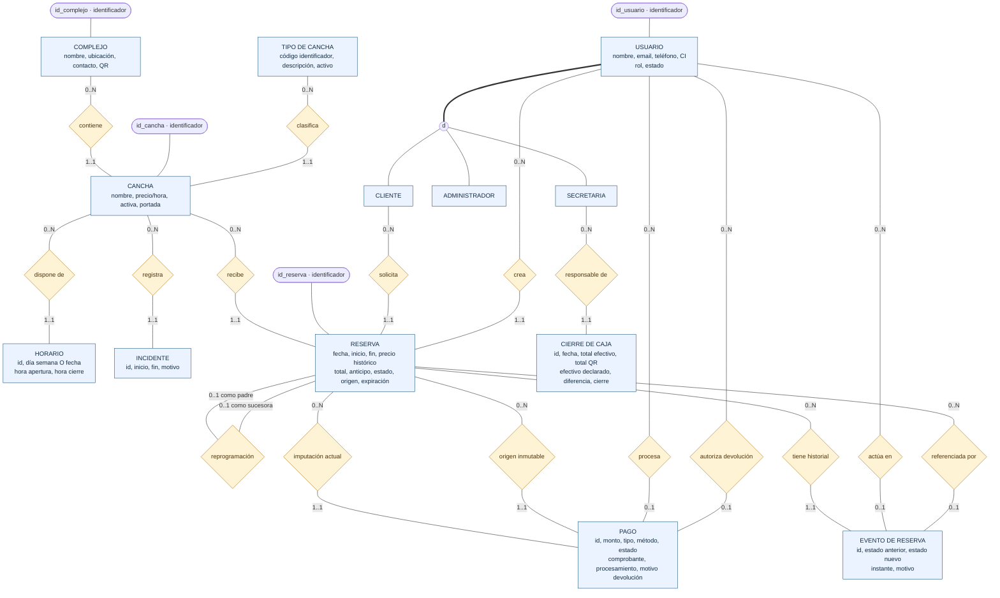
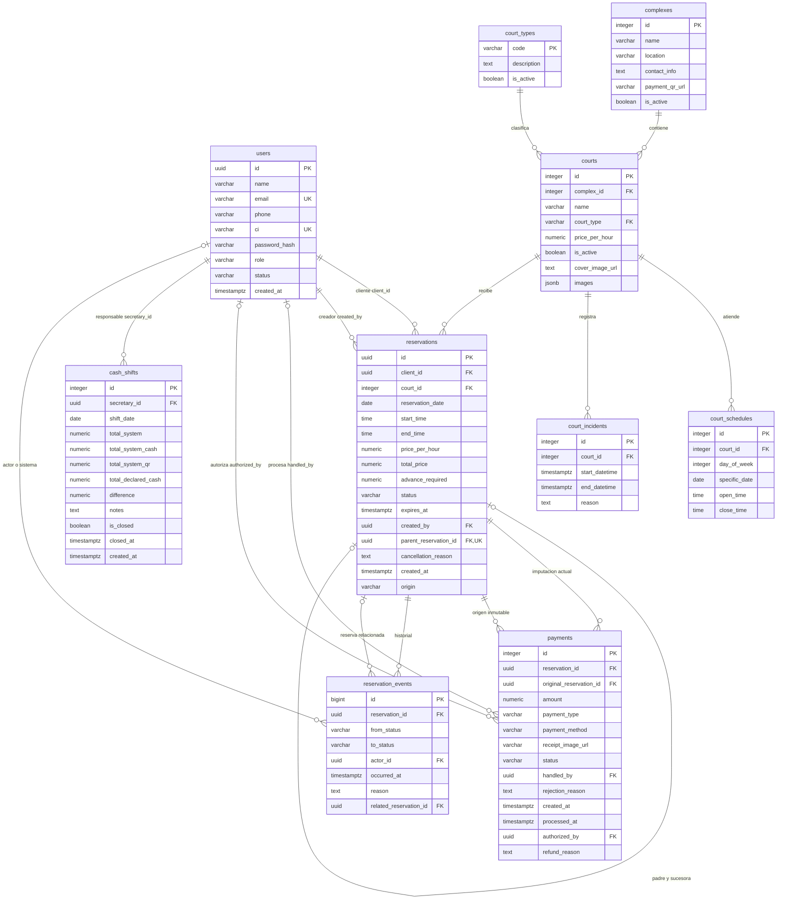

# Modelo Entidad–Relación Extendido — SportReserva

Basado en el esquema y diccionario locales del 24/09/2026. No se consultó la base remota en esta tarea.

## Vista conceptual extendida

Notación compacta: rectángulos = entidades; rombos = relaciones; óvalos = atributos identificadores; círculo `d` = especialización disjunta. Las etiquetas junto a cada entidad indican cuántas veces puede participar una instancia de esa entidad en la relación. `N` significa muchos. Se muestran atributos principales; el anexo relacional incluye las columnas.

## Cómo interpretar y defender el modelo

- **Especialización total y disjunta:** cada usuario tiene exactamente un rol: CLIENTE, SECRETARIA o ADMIN. La línea gruesa representa participación total en la especialización. Es una representación conceptual de `users.role`; no implica tres tablas adicionales ni herencia en TypeScript.
- **Roles de negocio y claves foráneas:** Cliente solicita y Secretaria cierra caja según el negocio. Las FK reales apuntan a `users`; una FK por sí sola no exige un rol concreto. Creador, procesador y autorizador se relacionan con Usuario porque las acciones dependen de permisos.
- **Reserva es una entidad asociativa:** resuelve la relación entre cliente y cancha a lo largo del tiempo y conserva fecha, horario y precio contratado.
- **Reprogramación:** una reserva tiene cero o una antecesora y cero o una sucesora directa. Pueden existir cadenas; no varias sucesoras directas de la misma reserva.
- **Dos relaciones Reserva–Pago:** `reservation_id` indica la imputación actual y `original_reservation_id` conserva el origen. No representan dos pagos.
- **Opcionalidad condicionada:** un pago pendiente puede carecer de procesador. Una devolución exige autorizador y motivo. Un evento de expiración automática puede carecer de actor.
- **Horario:** día semanal y fecha específica son excluyentes; se informa exactamente uno.
- **Atributos calculados:** total y anticipo se almacenan con restricciones de coherencia. El saldo pendiente se calcula a partir de pagos netos; no existe como columna. La diferencia de caja corresponde al efectivo declarado menos el efectivo del sistema.
- **Caja y pagos:** no existe `cash_shift_id` en pagos. El cierre agrupa movimientos por responsable y fecha de procesamiento; no se dibuja una FK inexistente.

## Fuentes

- [Esquema SQL](../../back-canchas-deportivas/database/schema.sql).
- [Diccionario de datos y restricciones](../../back-canchas-deportivas/docs/inspeccion/diccionario-datos.md).
- [Modelo relacional documentado](../02-database-supabase.md).

## Anexo: modelo relacional completo

La siguiente vista usa pata de cuervo: `||` = uno; `o|` = cero o uno; `o{` = cero o muchos. PK = clave primaria; FK = clave foránea; UK = unicidad. Complementa la vista conceptual con nombres físicos para cotejar la implementación.

