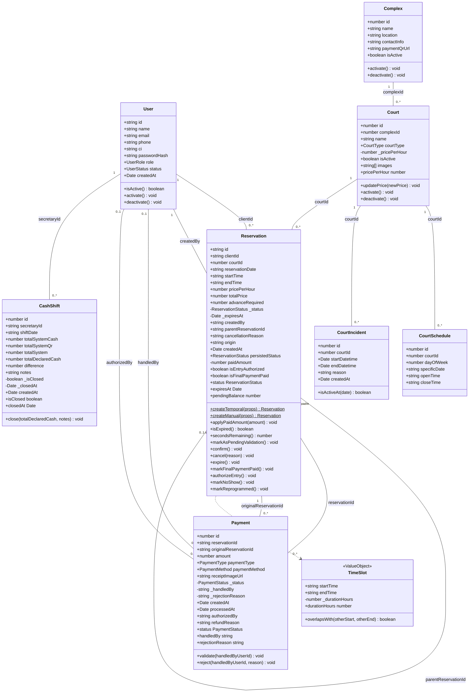

# Diagrama de clases de dominio — SportReserva

Vista UML de las ocho entidades implementadas y el objeto de valor `TimeSlot`, revisada contra el código local el 24/09/2026. Incluye atributos y operaciones principales; omite constructores y auxiliares privados. Las asociaciones representan referencias por identificador, no propiedades que contengan objetos cargados.

## Convenciones y alcance

`+` significa público; `-`, privado. Las fábricas `createTemporal` y `createManual` son estáticas. Los miembros `status`, `expiresAt`, `pendingBalance`, `pricePerHour`, `handledBy`, `rejectionReason`, `isClosed`, `closedAt` y `durationHours` representan getters. Para mantener legibilidad, las firmas resumen los parámetros; el código conserva sus tipos exactos y modificadores `readonly`.

Los tipos de los atributos se muestran sin la unión `null` ni `undefined`. Son opcionales o anulables: `Complex.paymentQrUrl`; `CourtSchedule.dayOfWeek/specificDate`; `Reservation._expiresAt/parentReservationId/cancellationReason/paidAmount`; `Payment.receiptImageUrl/_handledBy/_rejectionReason/processedAt/authorizedBy/refundReason`; `CashShift.notes/_closedAt`, además de sus getters correspondientes. Las cardinalidades hacen explícita la opcionalidad de las asociaciones.

| Tipo | Valores implementados |
|---|---|
| UserRole | CLIENTE, SECRETARIA, ADMIN |
| UserStatus | ACTIVE, INACTIVE, PENDING_VERIFICATION |
| ReservationStatus | TEMPORAL, PENDING_VALIDATION, CONFIRMED, CANCELLED, REPROGRAMMED, EXPIRED, NO_SHOW, COMPLETED |
| PaymentType | ANTICIPO, SALDO_FINAL, DEVOLUCION |
| PaymentMethod | QR, EFECTIVO |
| PaymentStatus | PENDING, VALIDATED, REJECTED, REFUNDED |
| CourtType | Alias de string; catálogo validado en persistencia |

## Diferencias respecto del diagrama de base de datos

- `User` representa todos los roles. No existen clases `Cliente`, `Secretaria` o `Administrador` que hereden de ella.
- `court_types` y `reservation_events` son tablas; no hay clases de entidad homónimas en los archivos de dominio revisados.
- `TimeSlot` es un objeto de valor usado por las fábricas de `Reservation`; no es tabla ni objeto almacenado como propiedad de la reserva. Por eso se representa una dependencia, no composición.
- `CourtIncident.createdAt` existe en la clase, pero no figura como columna en el diccionario físico revisado.
- `Court.images` expone la compatibilidad de imágenes; la base contiene `cover_image_url` y el espejo legado `images`.
- `Reservation.pendingBalance`, `paidAmount`, `isEntryAuthorized`, `isFinalPaymentPaid` y `persistedStatus` corresponden al comportamiento en memoria; no se deben convertir automáticamente en columnas. El getter de saldo tiene una alternativa de cotización cuando no se ha aplicado un monto pagado.
- Esta es una vista de dominio. Controladores, DTO, repositorios y casos de uso quedan fuera del alcance de este diagrama.

## Fuentes

Las clases se encuentran en `back-canchas-deportivas/src/modules/<módulo>/domain/entities/`. El objeto de valor está en [time-slot.vo.ts](../../back-canchas-deportivas/src/modules/reservations/domain/value-objects/time-slot.vo.ts).
