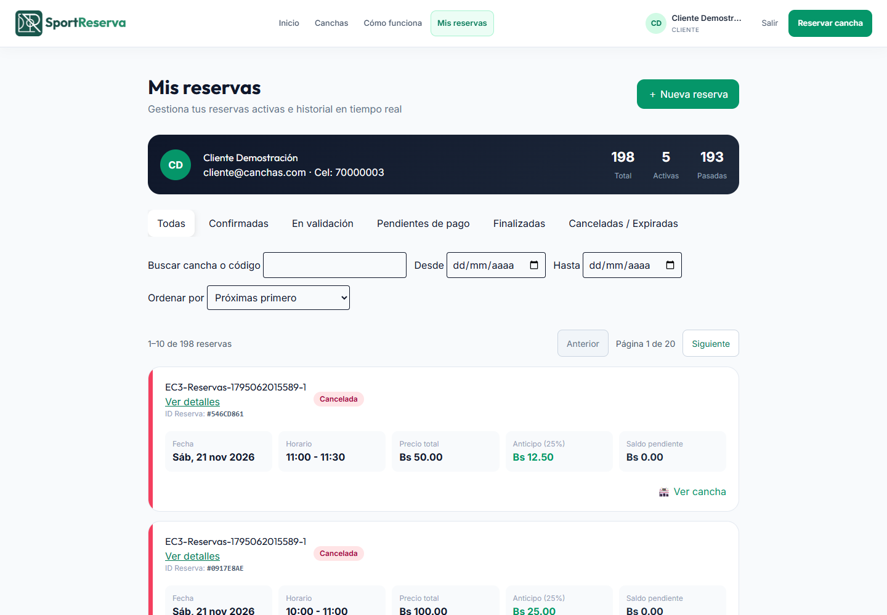
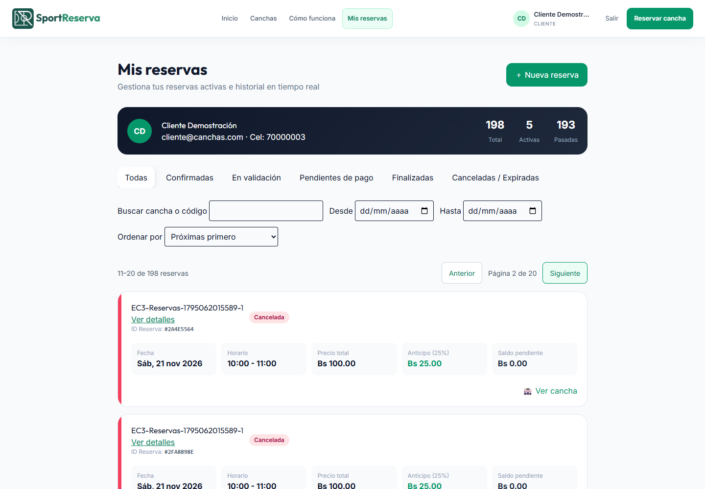
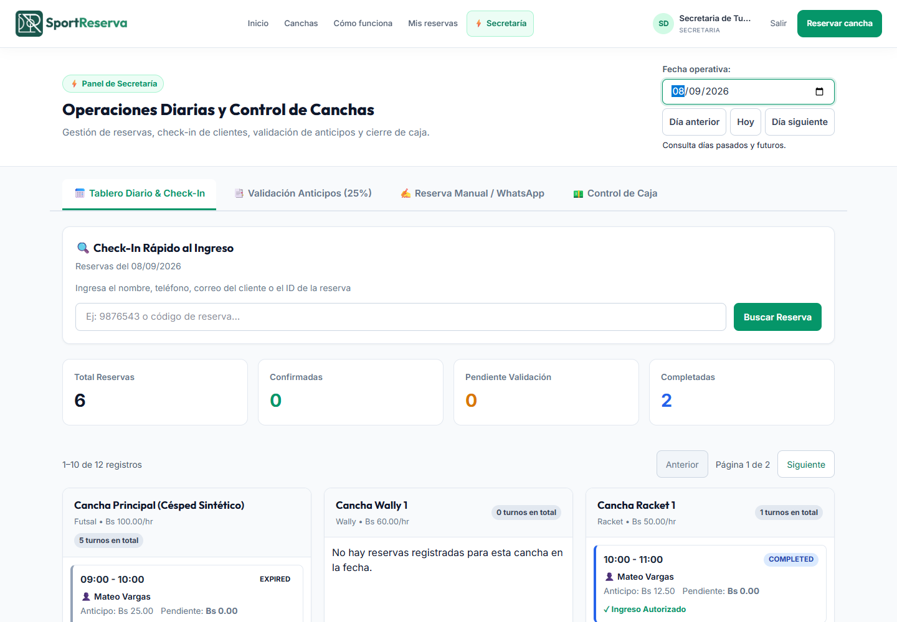
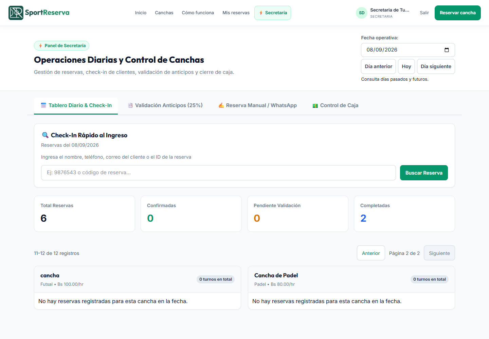
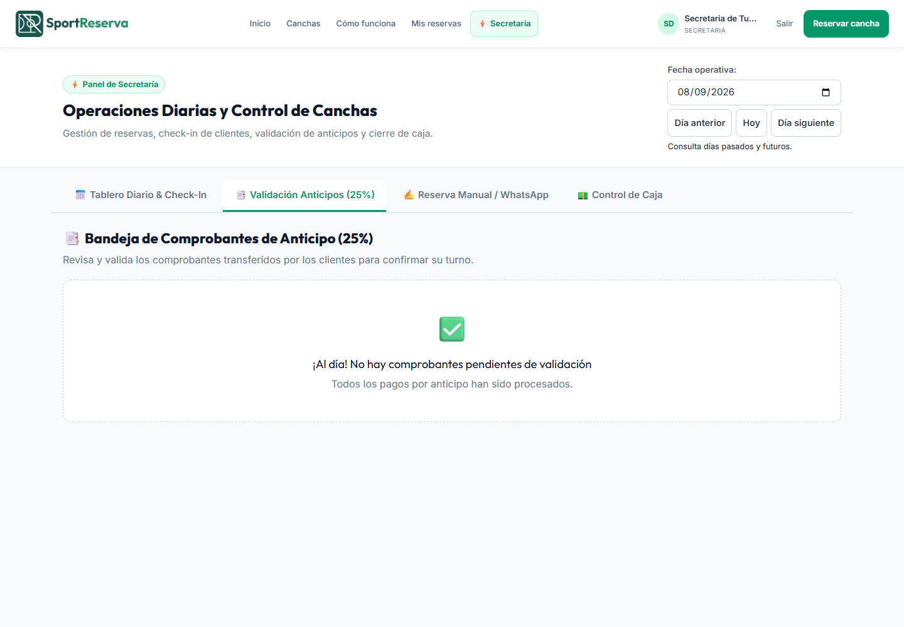

# Capturas actualizadas de paginación — 19/11/2026

Capturadas desde la aplicación local con las cuentas demo, después del cambio de paginación. Se usaron datos existentes y respuestas reales del backend. No se crearon reservas ni se modificaron pagos.

## Imágenes para el informe

### Figura 1. Mis reservas: primera página, filtros y total.

[Imagen completa de respaldo](evidencias/paginacion-2026-11-19/01-cliente-pagina-1-completa.png)

### Figura 2. Mis reservas: segunda página.

[Imagen completa de respaldo](evidencias/paginacion-2026-11-19/02-cliente-pagina-2-completa.png)

### Figura 3. Tablero de secretaría: primera página.

[Imagen completa de respaldo](evidencias/paginacion-2026-11-19/03-secretaria-tablero-pagina-1-completa.png)

### Figura 4. Tablero de secretaría: segunda página.

[Imagen completa de respaldo](evidencias/paginacion-2026-11-19/04-secretaria-tablero-pagina-2-completa.png)

### Figura 5. Bandeja de anticipos en su estado real actual.

[Imagen completa de respaldo](evidencias/paginacion-2026-11-19/05-secretaria-anticipos-completa.png)

## Interpretación y alcance

- Cliente: 198 reservas; se observó el cambio de registros 1–10 a 11–20, de un total de 20 páginas.
- Secretaría: se consultó el 08/09/2026 para mostrar un día con datos existentes. El tablero tiene 12 registros visuales: las reservas y las tarjetas de canchas vacías. El total de reservas del día es 6 y no debe confundirse con esos 12 registros.
- Se observó la navegación entre las páginas 1 y 2 del tablero y el botón Siguiente deshabilitado en la última página.
- Anticipos: la bandeja estaba vacía; esa captura demuestra el estado sin pendientes, no una segunda página de comprobantes.
- Estas imágenes documentan la interfaz actualizada. No constituyen una nueva ejecución de la suite EC3 de 216 pruebas.

Las imágenes sin el sufijo `-completa` tienen tamaño 1440 × 1000 para facilitar su inserción en el informe. Las completas conservan todo el contenido visible de la página seleccionada.
