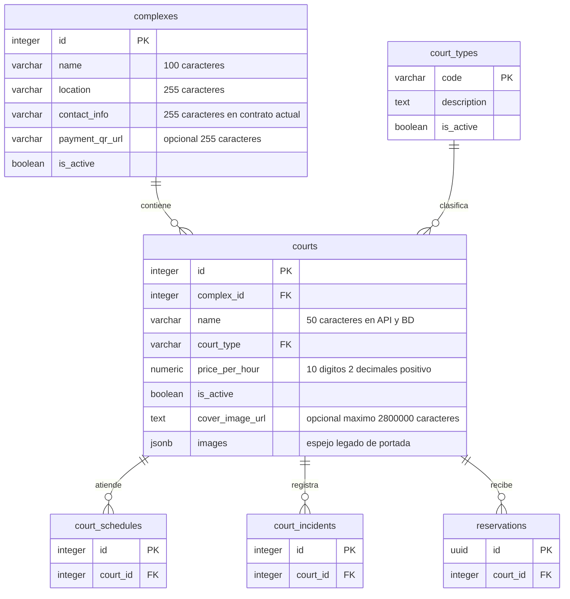
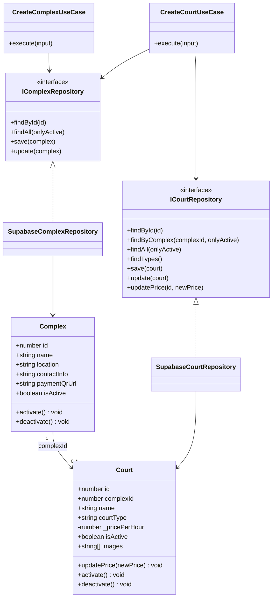

# Validación técnica del diseño de altas

Revisión del 18/11/2026 contra el esquema versionado `back-canchas-deportivas/database/schema.sql`, entidades, interfaces y casos de uso locales. Estos diagramas cubren las dos tablas del bloque; complementan el modelo general del informe. No se afirma una nueva inspección del esquema del servidor ni se ejecutan migraciones.

## Modelo relacional del bloque

Un complejo puede tener cero o muchas canchas; cada cancha pertenece a un complejo. El catálogo contiene Futsal, Wally, Racket y Padel. La portada se persiste en `cover_image_url`; el campo `images` se mantiene sincronizado por el esquema. Los nombres no se modelan como claves únicas. La baja de datos de prueba es lógica para conservar reservas y trazabilidad.

## Diagrama de clases de Crear

Se verifica la separación entre presentación (DTO/controlador), aplicación (caso de uso), dominio e infraestructura. La notación simplifica tipos de retorno Promise para legibilidad y omite controladores del gráfico. `paymentQrUrl` es nullable en Complex. La relación Complex–Court es por identificador, no por una colección de objetos almacenada en Complex.

## Observaciones para integrar el informe

- El límite visual del nombre de cancha es 30, aunque API/BD admiten 50. Debe explicarse como discrepancia, no modificar el modelo relacional para copiar el HTML.
- El atributo visual `min=1` no demuestra rechazo efectivo de importes inferiores; los tests verifican el recorrido completo. El contrato de backend exige importe positivo con dos decimales.
- El diagrama general de reservas debe revisarse con el responsable de transiciones antes de exportar el PDF; este bloque no certifica políticas ajenas de reprogramación ni el esquema desplegado completo.
- Robert puede integrar estos diagramas con [el modelo general](../../../../docs/02-database-supabase.md) y [arquitectura](../../../../docs/01-architecture-solid.md). Verificar legibilidad de las imágenes en el PDF final.
