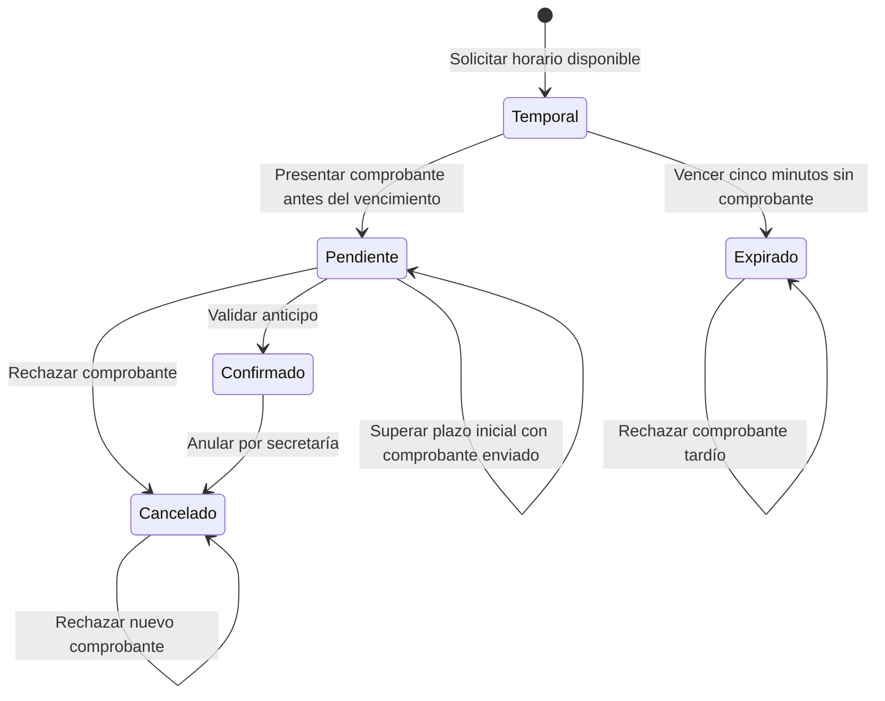

# Mateo — Diseño de caja negra y trazabilidad EC3

## Base de prueba y alcance

Recorrido confirmado por Mateo: **reserva del cliente**. Login mediante cuentas demo como precondición. Formulario principal: `/court-detail/:id`, selección de fecha y rango de horas; siguiente pantalla activa: `/payment`. No se incluye el formulario heredado `/booking-flow`, que no se atraviesa en este recorrido.

Bases: requisitos EC3; RN-01/RN-02 (30 minutos y extremos :00/:30), RN-03 (bloqueo 5 min), RN-04 (tarifa/anticipo), RN-06 (validación/rechazo) de `docs/03-business-rules.md`; HU-CLI-08, 10–14, 16, 18, 21 y HU-SEC-09/10/19. La HU-CLI-10 antigua menciona una hora: se utiliza la regla actualizada de treinta minutos y se declara la contradicción documental.

Teoría del docente: GCS T2-6, págs. 3–5 (base del diseño), 8–9 (EP), 25–30 (BVA 3), 42–49 (estados y cobertura). GCS T2-5, págs. 3–5 (comportamiento externo). No se usan ramas internas como criterio de cobertura.

**Regla de interfaz por confirmar en requisitos:** el selector anuncia máximo 3 horas. Se prueba ese límite tal como se ofrece al usuario, sin afirmar que es un límite global de la API. La documentación RN-01 no define máximo. Esto queda como diferencia de especificación a aclarar con el equipo.

## Precondiciones y datos comunes

La fixture crea datos EC3 propios por API: cancha habilitada, tarifa Bs 100/h, horario 08:00–23:00 todos los días. Fecha base D = hoy en America/La_Paz + 2 días. Cliente autenticado; para TE, secretaria en contexto separado. Limpieza de reservas activas creadas por cada caso y deshabilitación de la cancha al final, conservando historial.

Los campos efectivos del selector son cancha de la ruta, fecha, hora inicial y final. Duración, total y anticipo son calculados, no entradas editables. No hay campos de nombre/teléfono/notas que deban inventarse para este formulario.

## Particiones de equivalencia

| Elemento | Partición | Resultado esperado | Caso |
| --- | --- | --- | --- |
| Fecha | Anterior a hoy | Día no seleccionable | BVA-FEC-01 |
| Fecha | Hoy o futura | Día seleccionable; horarios dependen de disponibilidad | BVA-FEC-02/03 |
| Horas | Sin selección | No continuar | EP-RES-01 |
| Horas | Solo inicio | No continuar | EP-RES-02 |
| Duración UI | Rango permitido en bloques de 30 min, 30–180 | Crear Temporal y precio proporcional | BVA-DUR-02…05 |
| Duración UI | Cero | No crear rango; selección se limpia | BVA-DUR-01 |
| Duración UI | Mayor de 180 | Fin no seleccionable | BVA-DUR-06 |
| Disponibilidad | Horario retenido por Temporal | No seleccionable | EP-RES-05 |
| Inicio/fin API | Falta valor | Rechazo 400 con mensaje del campo | EP-API-01/02 |
| Fecha API | Vacía / formato incorrecto | Rechazo 400 | EP-API-03/07 |
| Horas API | Extremos :15 | Rechazo 400 por regla :00/:30 | EP-API-04 |
| Orden API | Fin anterior al inicio | Rechazo 400 | EP-API-05 |
| Cancha API | Identificador no positivo | Rechazo 400 | EP-API-06 |

Los casos API son complementarios de caja negra y se contabilizan aparte de los recorridos UI. Una validación negativa solo pasa si devuelve el rechazo esperado; un error 500 no se acepta como resultado correcto.

## BVA de tres valores

Dominio del selector: puntos separados por **30 minutos**, no minutos arbitrarios. Frontera inferior de duración: 0, 30, 60. Frontera superior ofrecida por UI: 150, 180, 210. El caso de 0 comprueba que el mismo punto no forma un rango; 210 comprueba bloqueo del botón. No se afirma que esas entradas fueron enviadas al servidor.

Fecha: dominio discreto de días; frontera de selección: ayer, hoy y mañana. La prueba de hoy comprueba elección de fecha, no disponibilidad de una hora que ya transcurrió.

| ID | Datos/acción desde la cancha en D | Resultado esperado |
| --- | --- | --- |
| BVA-DUR-01 | 10:00 y otra vez 10:00 | Limpiar; continuar deshabilitado |
| BVA-DUR-02 | 10:00–10:30 | Temporal; total 50; anticipo 12,50 |
| BVA-DUR-03 | 10:00–11:00 | Temporal; total 100; anticipo 25 |
| BVA-DUR-04 | 10:00–12:30 | Temporal; total 250; anticipo 62,50 |
| BVA-DUR-05 | 10:00–13:00 | Temporal; total 300; anticipo 75 |
| BVA-DUR-06 | Inicio 10:00, candidato fin 13:30 | Botón de fin deshabilitado |
| BVA-FEC-01 | Ayer | Día deshabilitado |
| BVA-FEC-02 | Hoy | Día habilitado |
| BVA-FEC-03 | Mañana | Día habilitado |

Estos casos también cubren las particiones indicadas; no se duplican solo para aumentar conteos. Las fronteras a precisión de un minuto de la API no se declaran cubiertas por esta BVA del selector.

## Otros casos del formulario

| ID | Pasos tras la precondición común | Resultado esperado |
| --- | --- | --- |
| EP-RES-01 | Observar antes de seleccionar horas | Continuar deshabilitado |
| EP-RES-02 | Elegir 10:00 sin fin | Continuar deshabilitado |
| EP-RES-03 | Elegir 10:00–11:00, pulsar Limpiar | Sin rango; continuar deshabilitado |
| EP-RES-04 | Elegir rango, cambiar a D+1 | Se elimina selección previa |
| EP-RES-05 | Crear Temporal 10:00–11:00; volver a cancha/D | 10:00 y 10:30 bloqueados |

API: partir del cuerpo válido `{courtId: canchaEC3, date: D, startTime: '10:00', endTime: '11:00'}`; sustituir solo los datos enumerados: EP-API-01 inicio vacío, 02 fin vacío, 03 fecha vacía, 04 extremos 10:15–11:15, 05 fin 09:30, 06 cancha 0, 07 fecha `17/11/2026`. Comparar código 400 y mensaje de la regla. No se consideran tests de integración entre módulos aislados.

## Modelo de estados elegido

El proceso es adecuado porque un comprobante produce resultados distintos según el estado previo. Temporal es necesario para modelar Expirado correctamente.

Modelo acotado al compromiso EC3, no máquina completa de todos los estados del producto. Las cancelaciones de limpieza no cuentan como cobertura de una transición bajo prueba.

| Caso | Precondición y secuencia | Verificaciones |
| --- | --- | --- |
| TE-01 | Crear Temporal por UI → adjuntar PNG sintético → enviar | Temporal antes; Pendiente después; mensaje visible |
| TE-02 | Temporal → enviar → secretaria aprueba por UI | Pendiente antes; Confirmado persistido después; pantalla cliente |
| TE-03 | Temporal → enviar → secretaria rechaza por UI con motivo | Cancelado; horario nuevamente elegible |
| TE-04 | Crear Temporal y cancelar por API como preparación → intentar nuevo comprobante por API | 400; conserva Cancelado |
| TE-05 | Crear y enviar; validar por API como preparación → secretaria anula por UI | Confirmado antes; Cancelado después; horario libre |
| TE-06 | Crear Temporal T y Pendiente P en intervalos distintos; esperar cinco minutos reales y cron; intentar comprobante tardío en T | T Expirado y horario libre; P sigue Pendiente y horario bloqueado; tardío rechazado sin reactivación |

TE-06 prueba varias obligaciones en una secuencia identificada; cuenta como **un test** de Playwright, aunque cubra tres elementos del modelo. La validación por API de TE-05 prepara el estado; la transición bajo prueba es la anulación por UI.

## Trazabilidad y cobertura

- `reservas-formularios.spec.ts`: 14 casos UI (5 EP + 9 BVA) y 7 funcionales API.
- `reservas-estados.spec.ts`: 6 casos (5 con acciones UI, incluyendo uno lento; 1 de evento inválido API).
- Total diseñado inicial: **27 tests**; no implica que hayan sido ejecutados ni aprobados.
- BVA: denominador 9 valores requeridos para las tres fronteras seleccionadas.
- EP: enumerar particiones ejercitadas de la tabla anterior; contar identificadores únicos, no duplicar por reutilizar un caso BVA.
- Estados: denominador 5 estados identificados.
- Cambios de estado válidos: denominador 5 flechas entre estados nombrados (Temporal→Pendiente, Temporal→Expirado, Pendiente→Confirmado, Pendiente→Cancelado, Confirmado→Cancelado).
- Respuestas sin cambio: 3 (Pendiente tras plazo, Cancelado ante comprobante, Expirado ante comprobante tardío).

Registrar por separado cobertura ejercitada y resultados aprobados. Si un test falla antes de llegar a una transición, esa transición no se declara ejercitada. Una cobertura del 100% de este modelo no demuestra ausencia de defectos ni cobertura de todos los flujos de SportReserva.

## Insumos para Robert

Usar este diseño, el README de la suite, JSON/HTML de la corrida identificada y capturas adjuntas. Añadir fecha, versiones, comando, resultados reales y defectos. No sumar la preparación administrativa como pruebas de Marcelo ni declarar completo el pago total de Ostin por haber validado solo un anticipo.
